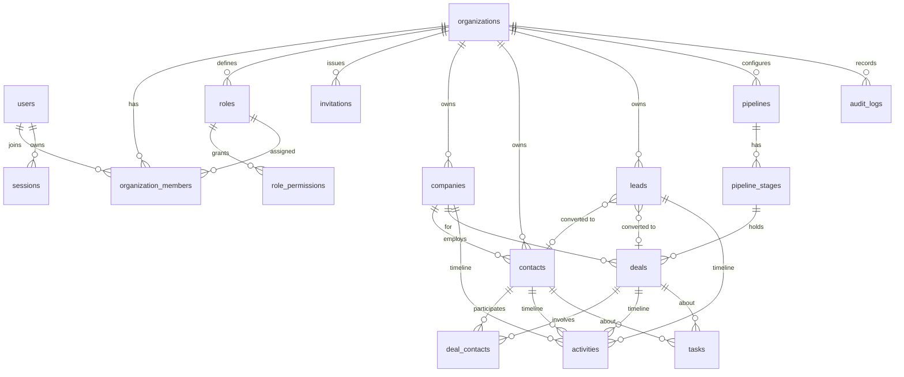

# Database design

PostgreSQL 15+. Drizzle schema in `src/server/db/schema/`, SQL migrations in `drizzle/` (`0000_initial_schema.sql` generated; `0001_rls_roles_grants.sql` hand-written). UUID primary keys (`gen_random_uuid()`), all timestamps `timestamptz` (UTC), money `numeric(18,2)` + `char(3)` ISO currency.

## Tenancy model
Global tables: `users`, `sessions`, `auth_events`. Tenant root: `organizations`. Every other table has `organization_id NOT NULL` and:
1. `UNIQUE (organization_id, id)` so children reference parents with a **composite FK** `(organization_id, parent_id)` — a row in org B can never point at a row in org A, even via the owning connection (tested).
2. **Row-level security**: policy `organization_id = app_org_id()` (reads `app.org_id`, set per transaction) `TO onecrm_app`; unset ⇒ zero rows (tested).
3. A guard test fails if any table with `organization_id` lacks RLS.

Owners/assignees use composite FKs to `organization_members(organization_id, user_id)`, so a record can only be owned by a member of the same organization.

## Entities (implemented)
| Group | Tables |
|---|---|
| Identity | `users`, `organizations`, `organization_members`, `roles`, `role_permissions`, `invitations`, `sessions`, `auth_events` |
| CRM | `companies`, `contacts`, `leads` |
| Sales | `pipelines`, `pipeline_stages`, `deals`, `deal_contacts` |
| Workforce | `tasks`, `activities` |
| Platform | `audit_logs` |

Not yet created (designed in the brief): conversations/messages, campaigns, tickets, knowledge, quotes/invoices/payments, projects, workflows, AI tables, notifications, files, integrations, webhooks, subscriptions, consent/retention.

## Key constraints
- `contacts`: unique `lower(email)` per org among non-deleted rows (prevents duplicate customer records).
- `companies`: unique `lower(domain)` per org among non-deleted.
- `deals`: `(org, pipeline, stage)` FK to `pipeline_stages` — a deal can only sit in a stage of its own pipeline; `amount >= 0`; status/probability CHECKs; status is derived from stage kind in the service.
- `activities`: CHECK at least one of contact/company/lead/deal; type CHECK; system rows immutable via service.
- `invitations`: one pending invite per `(org, lower(email))`; token stored only as SHA-256.
- `audit_logs`: app role has INSERT+SELECT only.
- Soft delete (`deleted_at`) on contacts, companies, leads, deals, tasks, organizations; hard delete is not offered.
- `version int` on updatable records for optimistic concurrency.

## Grants (role `onecrm_app`, NOLOGIN, NOBYPASSRLS)
CRUD on tenant tables; no INSERT/DELETE on `organization_members`; SELECT/UPDATE on own `organizations` row; column-level SELECT on `users(id,email,name,email_verified_at,created_at)` (never `password_hash`) restricted by RLS to members of the current org; **no access** to `sessions`/`auth_events`.

## ER diagram

## Migrations
`npm run db:generate` after schema edits; hand-written SQL (RLS/grants for new tables) goes in a `--custom` migration. Migrations are applied automatically at start-up. A new tenant table **must** be added to the RLS list in a new migration — the schema-guard test will fail otherwise.
